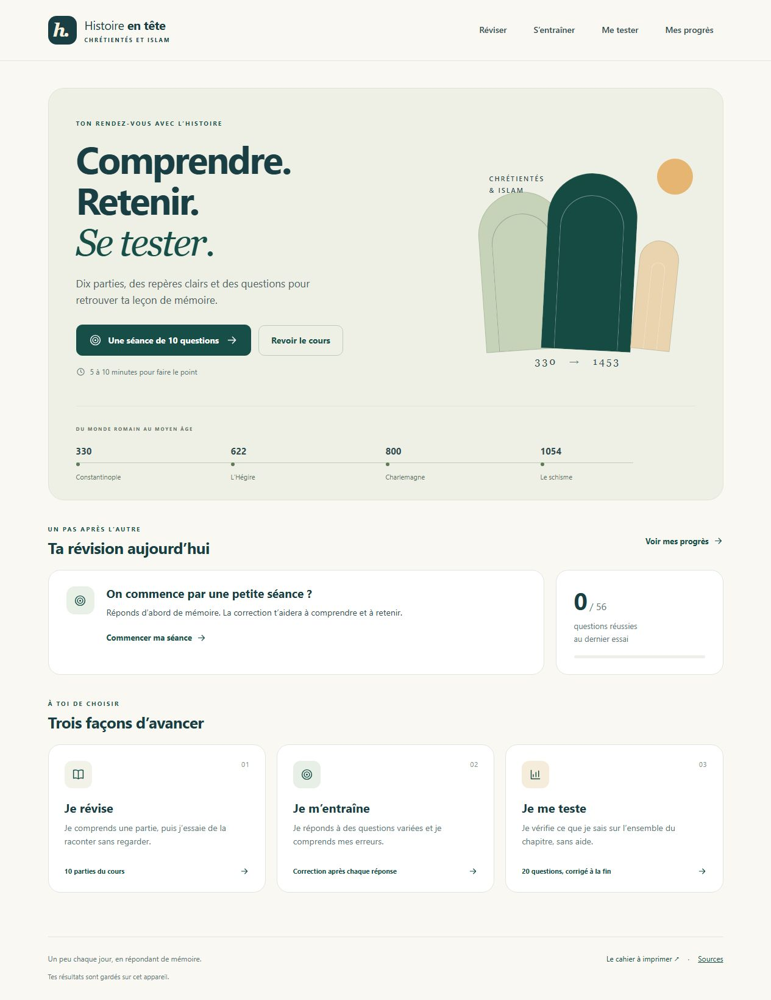

# Histoire en tête

Un site simple pour réviser **Chrétientés et islam** et tester ses connaissances.



## Ce que le site propose

- Dix parties du cours : H1 à H9 et H11, avec des explications et les repères essentiels.
- 56 questions : 32 réponses courtes et 24 questions à choix multiples.
- Des séances de dix questions au maximum, avec une correction après chaque réponse.
- Un mini-contrôle de vingt questions, deux par partie, avec les corrigés à la fin.
- Des questions ratées à retravailler et des rappels espacés pour les réponses réussies.
- Un suivi des résultats sur l’appareil utilisé et la reprise des séances en cours.
- Un affichage adapté au téléphone et un cahier PDF à imprimer.

## Lancer le site en local

Depuis la racine du dépôt, avec Python installé :

```sh
python -m http.server 8000 --directory dist
```

Ouvrir ensuite [http://localhost:8000](http://localhost:8000).

Le site utilise des modules JavaScript : il faut le servir avec un serveur HTTP pour que les quiz fonctionnent.

## Vérifier le fonctionnement

Avec Node.js installé :

```sh
node verify.mjs
```

Les vérifications couvrent les réponses courtes, les réponses incorrectes ou vides, la sélection des questions, le calcul du score, les intervalles de révision et la reprise des séances sauvegardées.

## Modifier le cours et les questions

Le cours se trouve dans `sources/fiches-contenu.json`. Les questions sont définies dans `preparer-contenu.py`.

Après une modification, régénérer les données du site :

```sh
python preparer-contenu.py
node verify.mjs
```

Le fichier `dist/content.mjs` est généré par ce script. Le cahier `dist/cahier-revision.pdf` est un document indépendant : la génération du contenu du site ne le modifie pas.

Les nombres de questions et de parties sont vérifiés dans `verify.mjs` ; adapter ces assertions si la taille du chapitre change.

## Organisation

```text
dist/
  index.html          Page et navigation
  styles.css          Présentation et affichage mobile
  app.mjs             Cours, quiz et suivi
  core.mjs            Correction, sélection et sauvegarde
  content.mjs         Contenu généré
  cahier-revision.pdf  Cahier imprimable
sources/
  fiches-contenu.json  Contenu du cours
docs/
  apercu.jpg           Capture de l’accueil
preparer-contenu.py    Génération des données
verify.mjs            Vérifications
```

## Hébergement et résultats

Le dossier `dist` peut être servi par un hébergement statique. L’application ne nécessite aucune compilation ni base de données.

Les résultats sont enregistrés dans le navigateur avec `localStorage`. Ils ne sont pas synchronisés entre les appareils. Le bouton « Effacer mes résultats » permet de recommencer.

Une [version hébergée avec Sites](https://heloise-histoire-chretientes-islam.plucky-comet-8103.chatgpt.site) existe également. Elle est privée et demande une connexion avec le compte ChatGPT propriétaire.

## Sources pédagogiques

Le contenu reprend les synthèses du cours fourni, parties H1 à H9 et H11. La méthode combine rappel actif, correction et révisions espacées. Les délais proposés sont des repères pratiques à adapter.

- [Dunlosky et collègues, 2013 — techniques d’apprentissage](https://doi.org/10.1177/1529100612453266).
- [Agarwal, Nunes et Blunt, 2021 — rappel actif en classe](https://doi.org/10.1007/s10648-021-09595-9).
